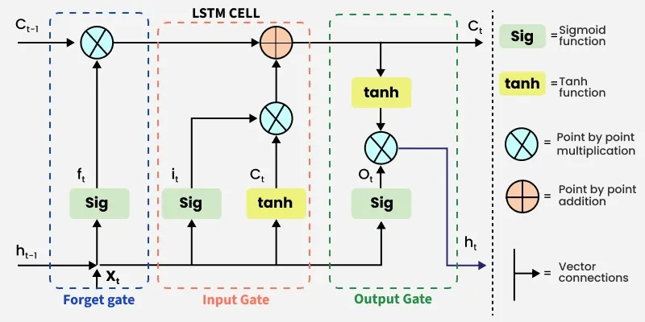
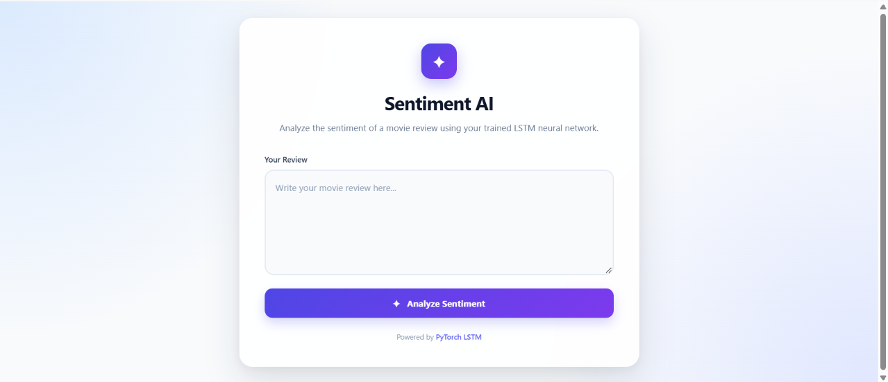
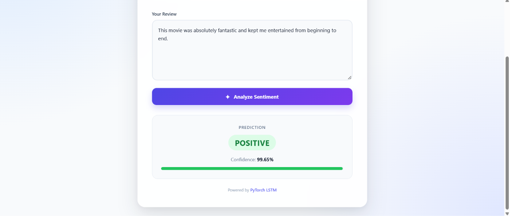
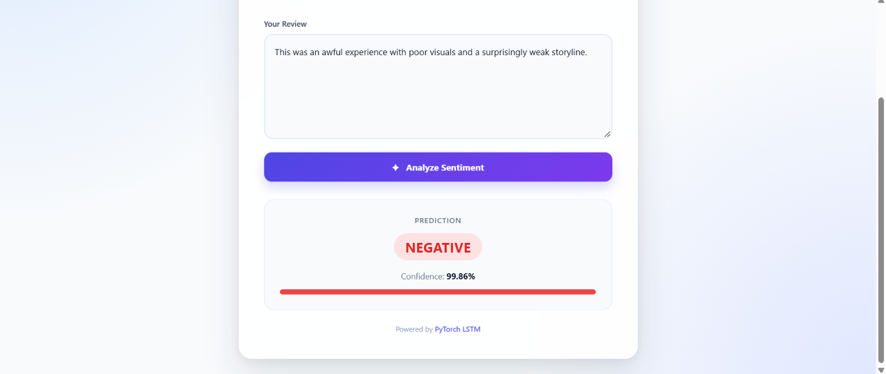

# IMDb Sentiment Analysis using LSTM



## Overview & Project Goal

The goal of this project is to build, train, and deploy a Deep Learning Natural Language Processing (NLP) model capable of classifying movie reviews from the IMDb dataset as either Positive or Negative.

Using a Long Short-Term Memory (LSTM) recurrent neural network implemented in PyTorch, the model captures sequential dependencies in text to understand sentiment. Additionally, the repository includes an interactive Flask web application that allows users to input custom movie reviews and receive real-time sentiment predictions along with confidence scores.

---

## Web Application Interface

Below are screenshots demonstrating the Flask web application in action:

### 1. Main Review Input Interface
The initial home interface where users can write or paste a movie review for analysis.



### 2. Positive Sentiment Prediction
Displays the predicted positive sentiment tag along with the model confidence score and a visual green progress bar.



### 3. Negative Sentiment Prediction
Displays the predicted negative sentiment tag along with the model confidence score and a visual red progress bar.



---

## Technologies & Tools Used

- Deep Learning Framework: PyTorch (torch, torch.nn, DataLoader, TensorDataset)
- Natural Language Processing (NLP): NLTK (stopwords), Regular Expressions, Custom Vocabulary and Tokenization
- Data Manipulation & Analysis: NumPy, Pandas
- Data Visualization: Matplotlib, Seaborn
- Web Deployment: Flask (HTML templates, pickle for vocabulary serialization)
- Hardware Acceleration: CUDA support with automatic fallback to CPU

---

## Project Structure

```text
ImdbSentimentAnalysisLstm/
├── imdb_sentiment_analysis_app/       # Flask web application for inference
│   ├── templates/
│   │   └── index.html                 # Web interface template
│   ├── app.py                         # Flask server and prediction route
│   ├── model.py                       # SentimentLSTM model definition
│   ├── model_state_dict.pt            # Saved PyTorch model state dictionary
│   ├── requirements.txt               # Web app dependencies
│   ├── vocabulary.pkl                 # Serialized word-to-index dictionary
│   ├── Screenshot-app.png             # Initial web interface screenshot
│   ├── Screenshot-analysedpositive.png# Positive prediction screenshot
│   └── Screenshot-analysednegative.png# Negative prediction screenshot
├── imdb_dataset.csv                   # Combined IMDb review dataset
├── main.py                            # End-to-end data preprocessing, training and evaluation script
├── checkpoints/                       # Training artifacts created by main.py
│   ├── model_state_dict.pt            # Trained PyTorch model state dictionary
│   └── vocabulary.pkl                 # Serialized word-to-index dictionary
├── RNN-LSTM.webp                      # Architecture diagram
└── README.md                          # Project documentation
```

---

## How the Model is Trained

The training pipeline in main.py follows an end-to-end machine learning workflow:

### 1. Data Preprocessing & Vocabulary Building
- Text Cleaning: Punctuation, special characters, and digits are removed from each review using regular expressions.
- Stop-word Removal: Common English stop words (such as the, is, a, and) are filtered out using the NLTK corpus.
- Vocabulary Construction: Word frequencies are counted across the dataset using Counter, and the top 1,000 most frequent words are mapped to integer identifiers, reserving index 0 for padding.
- Tokenization & Encoding: Reviews are converted into sequences of integer token identifiers, while labels are encoded as 1 for positive and 0 for negative.
- Outlier Removal & Left Padding: Empty reviews are filtered out. All remaining sequences are truncated or left-padded with zeros to a fixed sequence length of 12 tokens.

### 2. Dataset Splitting & Batching
- The dataset is shuffled with a fixed random seed before splitting into 50% training, 25% validation, and 25% test data.
- Each split is wrapped in a PyTorch TensorDataset and loaded with a batch size of 50. Training batches are shuffled, while validation and test batches retain their split order.

### 3. Model Architecture (SentimentLSTM)
The neural network consists of the following layers:
1. Embedding Layer (nn.Embedding): Converts integer token indices (vocabulary size of up to 1,001 including padding index 0) into dense vectors of size 128.
2. Stacked LSTM Layer (nn.LSTM): A 2-layer LSTM (hidden dimension of 128, dropout probability of 0.3) that processes the embedded token sequences and extracts temporal features from the final time step.
3. Dropout Layer (nn.Dropout): Applies a 0.3 dropout probability for regularization to prevent overfitting.
4. Fully Connected Layer (nn.Linear): Maps the 128-dimensional hidden state to a single raw logit output, passed through a Sigmoid activation during inference.

### 4. Training & Optimization
- Loss Function: Binary Cross-Entropy with Logits (BCEWithLogitsLoss), combining a Sigmoid layer and BCELoss in a numerically stable manner.
- Optimizer: Adam optimizer with a learning rate of 0.001.
- Gradient Clipping: Uses gradient norm clipping set to 5 during backpropagation to prevent the exploding gradient problem common in RNNs and LSTMs.
- Epochs & Checkpointing: Trained for 5 epochs with training and validation loss and accuracy tracked and plotted at each epoch. The trained model state dictionary and vocabulary are saved in the checkpoints directory.

---

## Getting Started

### Prerequisites

Install the required Python packages:

```bash
pip install torch numpy pandas seaborn matplotlib nltk flask
```

Ensure the NLTK English stopwords corpus is downloaded:

```python
import nltk
nltk.download('stopwords')
```

### 1. Train & Evaluate the Model

Run the main training script from the root directory:

```bash
python main.py
```

This script will:
- Load and visualize the dataset distribution.
- Preprocess text, train the SentimentLSTM model, and plot Loss and Accuracy curves.
- Evaluate the internal test split after training.
- Save the trained model state dictionary and vocabulary in the checkpoints directory.
- Open an interactive command-line prompt to test custom reviews.

### 2. Run the Flask Web Application

Navigate to the web app directory, install its dependencies, and start the Flask server:

```bash
cd imdb_sentiment_analysis_app
pip install -r requirements.txt
python app.py
```

Open your browser at localhost:5000 (or 127.0.0.1:5000) to enter movie reviews and see the predicted sentiment (Positive or Negative) and confidence score.
